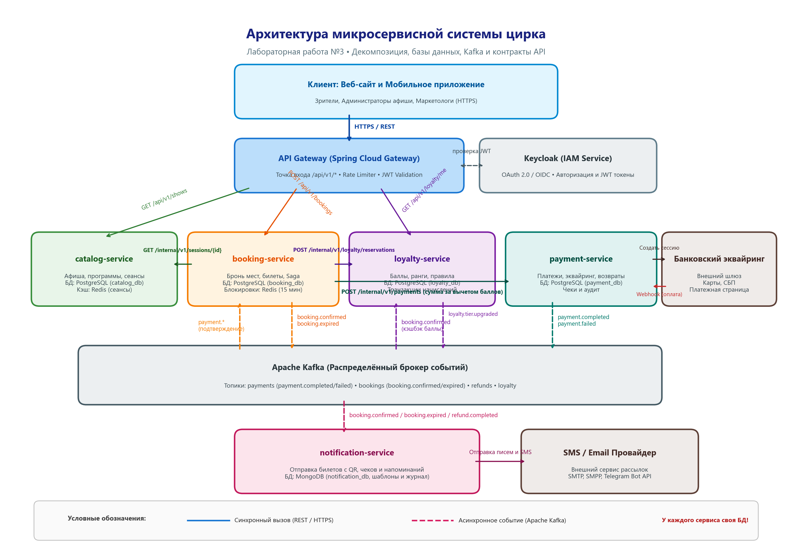
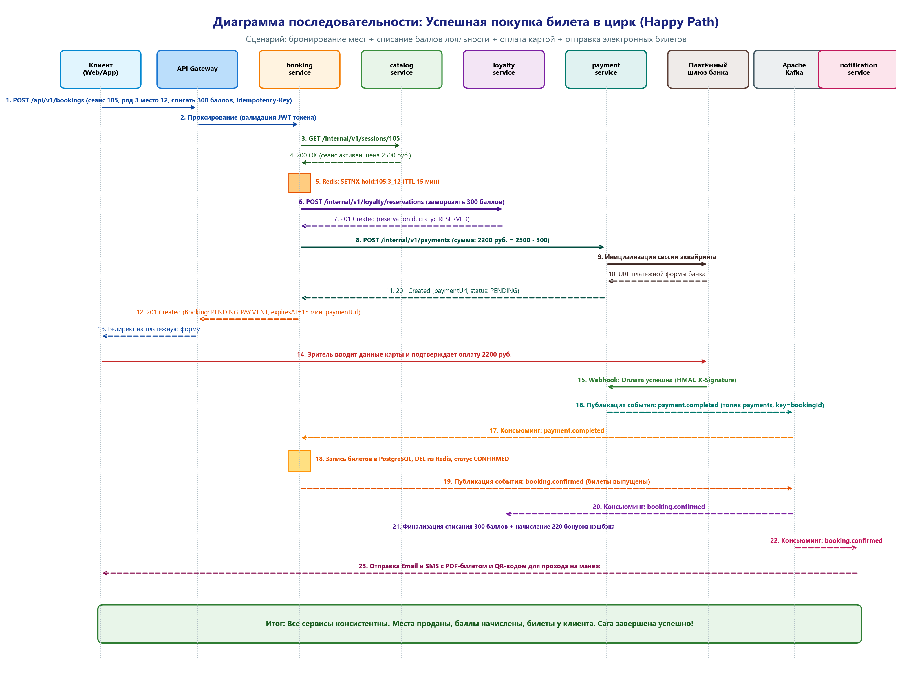
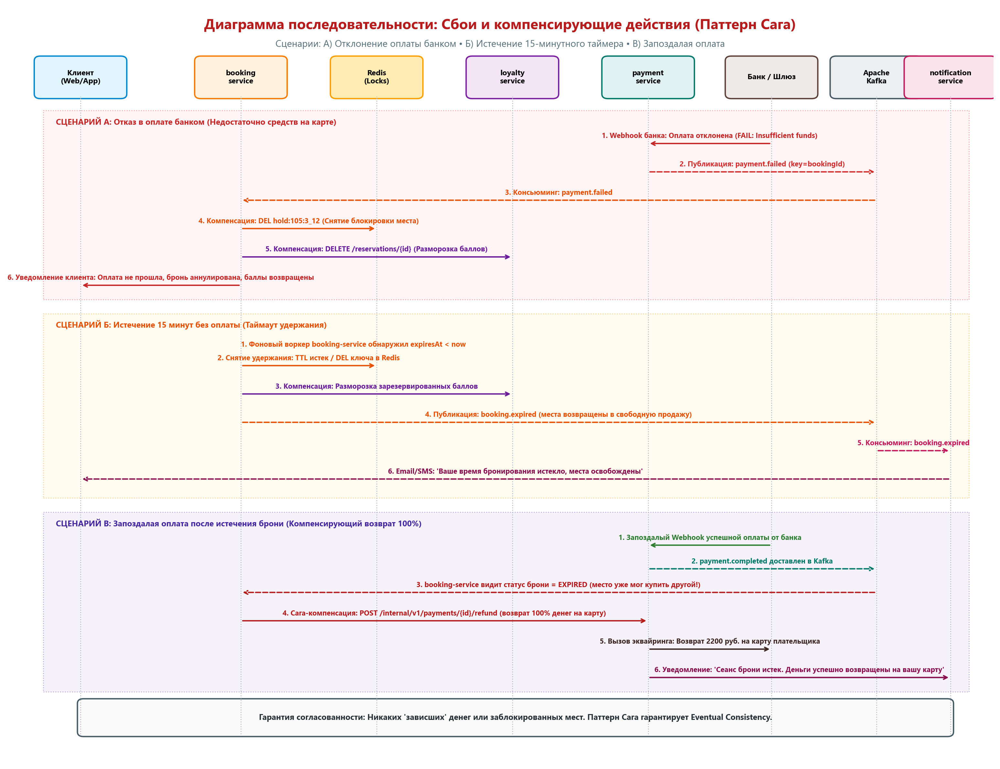

# Лабораторная работа №3. Декомпозиция и проектирование микросервисной системы

**Тема:** Проектирование микросервисной архитектуры информационной системы цирка («Цирк на Манеже»)  
**Предметная область:** Продажа билетов на цирковые представления, управление репертуарной афишей, программа клиентской лояльности и сервис информирования зрителей.

---

## 1. Анализ предметной области

### 1.1. Описание системы
Информационная система цирка предназначена для зрителей, администраторов цирковых программ и маркетологов. Система предоставляет интерактивную онлайн-афишу цирковых представлений с возможностью фильтрации по жанрам, датам и возрастным категориям, а также интерактивный выбор мест вокруг манежа (партер, амфитеатр, ложи). 

Зарегистрированные пользователи могут приобретать электронные билеты, частично оплачивать заказы накопленными бонусами и участвовать в многоуровневой программе цирковой лояльности. Система обеспечивает надежное удержание мест на время оплаты (15 минут), осуществляет фискализацию и приём платежей через банковский эквайринг, генерирует электронные билеты с защищёнными QR-кодами для прохода в зал и обеспечивает доставку билетов и сервисных уведомлений на Email и SMS. Администраторы цирка централизованно ведут афишу и расписание сеансов, а маркетологи настраивают динамические правила начисления бонусов и запускают промоакции.

### 1.2. Акторы системы
* **Зритель (зарегистрированный пользователь):** просматривает афишу, выбирает сеансы и конкретные места на схеме манежа, списывает бонусные баллы, оплачивает билеты, получает билеты с QR-кодами, отслеживает свой статус лояльности и при необходимости запрашивает возврат билетов.
* **Гость (неавторизованный пользователь):** просматривает цирковую афишу, описания шоу и расписание представлений, проходит регистрацию.
* **Администратор цирка:** создаёт, редактирует и архивирует цирковые представления, формирует сетку расписания сеансов, назначает цены по секторам зала.
* **Маркетолог цирка:** анализирует продажи, создаёт маркетинговые правила начисления повышенных бонусов (например, на утренние семейные показы) и инициирует таргетированные рассылки.
* **Внешний платёжный шлюз (банковский эквайринг):** обеспечивает безопасный ввод реквизитов карт, проведение платежей через СБП/МИР и обработку возвратов средств.
* **Внешний провайдер рассылок (SMS/Email Gateway):** осуществляет физическую доставку писем с билетами и SMS-кодов зрителям.
* **Keycloak (Identity & Access Management):** внешний инфраструктурный сервис аутентификации и авторизации (OAuth 2.0 / OpenID Connect), выпускающий JWT-токены.

### 1.3. Ключевые пользовательские сценарии (User Stories)
1. **US-1 (Поиск представления):** Как зритель, я хочу фильтровать афишу по жанрам («Акробатика», «Клоунада», «Иллюзия») и датам, чтобы выбрать подходящее цирковое шоу для всей семьи.
2. **US-2 (Выбор мест и бронирование):** Как зритель, я хочу выбрать свободные места на интерактивной схеме манежа и временно закрепить их за собой на 15 минут, чтобы успеть спокойно оплатить заказ без риска потери мест.
3. **US-3 (Оплата с использованием бонусов):** Как зритель, я хочу использовать накопленные баллы лояльности для получения скидки на билет, чтобы сэкономить деньги.
4. **US-4 (Получение электронного билета):** Как зритель, я хочу сразу после успешной оплаты получить электронный билет с QR-кодом на email и SMS, чтобы предъявить его контролёру при входе в цирк.
5. **US-5 (Управление афишей):** Как администратор цирка, я хочу добавлять новые цирковые программы и открывать продажи на сеансы, чтобы зрители видели актуальный репертуар.
6. **US-6 (Возврат билета со штрафом):** Как зритель, я хочу иметь возможность вернуть билет при невозможности посетить шоу, понимая, что по правилам цирка мне возвращается до 50% стоимости, а в программе лояльности аннулируются начисленные за заказ баллы.
7. **US-7 (Прогресс в программе лояльности):** Как зритель, я хочу видеть свой уровень («Новичок», «Знаток манежа», «Почётный зритель») и историю начислений, чтобы знать процент доступного кэшбэка.
8. **US-8 (Маркетинговые акции):** Как маркетолог, я хочу настраивать повышенный кэшбэк (например, +10% бонусов) на премьерные или утренние сеансы, чтобы стимулировать заполняемость зала.

### 1.4. Доменные события (Event Storming)
* `ShowCreated` — администратор создал новое цирковое шоу.
* `ShowUpdated` — администратор обновил информацию о шоу.
* `ShowArchived` — шоу снято с активного репертуара.
* `SessionScheduled` — сеанс добавлен в расписание цирка.
* `BookingCreated` — зритель зарезервировал места на сеанс (статус `PENDING_PAYMENT`, таймер 15 минут).
* `BookingConfirmed` — оплата подтверждена, места зафиксированы, сгенерированы билеты.
* `BookingCancelled` — бронь отменена зрителем или из-за отказа в оплате.
* `BookingExpired` — бронь аннулирована по истечении 15-минутного таймаута без оплаты.
* `PaymentCompleted` — платёж успешно проведён через банковский эквайринг.
* `PaymentFailed` — платёж отклонён банком (недостаток средств, сбой авторизации карты).
* `RefundRequested` — зритель запросил возврат билета.
* `RefundCompleted` — средства (50% от стоимости) возвращены на карту плательщика.
* `PointsReserved` — баллы лояльности временно заморожены под оформляемую бронь.
* `PointsRedeemed` — баллы окончательно списаны в счёт скидки на билет.
* `PointsAccrued` — начислен бонусный кэшбэк за посещение представления.
* `TierUpgraded` — зритель перешёл на новый уровень привилегий цирка.
* `PenaltyApplied` — списаны баллы и снижен ранг зрителя при возврате билета.
* `NotificationDispatched` — электронный билет или сервисное оповещение доставлено получателю.

### 1.5. Ограниченные контексты (Bounded Contexts) и глоссарии

```
+---------------------------------------------------------------------------------+
|                                 СИСТЕМА ЦИРКА                                    |
+---------------------+---------------------+---------------------+---------------+
|      КАТАЛОГ        |    БРОНИРОВАНИЕ     |      ОПЛАТА         |   ЛОЯЛЬНОСТЬ  |
|  (catalog-service)  |  (booking-service)  |  (payment-service)  | (loyalty-svc) |
+---------------------+---------------------+---------------------+---------------+
                                        |                                 |
                                        +----------------+----------------+
                                                         |
                                            +---------------------------+
                                            |        УВЕДОМЛЕНИЯ        |
                                            |   (notification-service)  |
                                            +---------------------------+
```

#### 1. Контекст: Каталог цирковых программ (Catalog Context)
*Отвечает за:* ведение репертуара цирка, описание представлений, возрастные цензы, расписание сеансов и базовые тарифы по секторам манежа.
*Глоссарий:*
* **Шоу (Show):** основная творческая единица (например, «Магия цирка: Полёт над манежем»), обладающая длительностью, жанром и возрастным рейтингом.
* **Сеанс (Session):** конкретный показ шоу в определённую дату и время в зале цирка.
* **Сектор манежа (Sector):** зона зрительного зала (Партер А, Партер Б, Амфитеатр, Ложа), определяющая базовую ценовую категорию места.
* **Афиша (Playbill):** агрегированное представление актуальных сеансов для публикации на витрине.

#### 2. Контекст: Бронирование и продажа билетов (Booking Context)
*Отвечает за:* жизненный цикл брони, резервирование мест на 15 минут, выпуск билетов с QR-кодами, фиксацию факта посещения и оформление возвратов.
*Глоссарий:*
* **Бронь (Booking):** заказ на покупку одного или нескольких мест, находящийся в статусе ожидания оплаты (`PENDING_PAYMENT`), подтверждения (`CONFIRMED`) или отмены (`CANCELLED`/`EXPIRED`).
* **Удержание места (Seat Hold):** временная распределённая блокировка места в Redis с временем жизни (TTL) 15 минут.
* **Электронный билет (Ticket):** фискализованный документ с уникальным номером и QR-кодом для валидации на турникете цирка.
* **Возврат билета (Ticket Refund):** процедура добровольного отказа от посещения до начала сеанса с возвратом 50% стоимости.

#### 3. Контекст: Оплата и эквайринг (Payment Context)
*Отвечает за:* интеграцию с банковским эквайрингом, фискализацию чеков в соответствии с законодательством, фиксацию платежей и перечисление средств при возвратах.
*Глоссарий:*
* **Платёж (Payment):** финансовая транзакция списания денежных средств (в рублях) за вычетом суммы бонусной скидки.
* **Платёжная сессия (Payment Session):** временная ссылка/токен для безопасного перенаправления клиента на форму банка.
* **Чек (Receipt):** фискальный чек, сформированный оператором фискальных данных (ОФД).
* **Возврат средств (Payment Refund):** обратная финансовая проводка на банковскую карту плательщика.

#### 4. Контекст: Программа лояльности (Loyalty Context)
*Отвечает за:* учёт бонусных счетов зрителей, заморозку баллов, списание в счёт скидки, начисление кэшбэка и управление статусами клиентов.
*Глоссарий:*
* **Бонусный баланс (Loyalty Balance):** количество активных бонусных рублей на счёте зрителя (1 балл = 1 рубль скидки).
* **Резерв баллов (Points Reservation):** временная блокировка баллов зрителя на время действия бронирования.
* **Уровень привилегий (Tier):** статус зрителя в цирке («Новичок» — 5% кэшбэк, «Знаток манежа» — 10% кэшбэк, «Почётный зритель» — 15% кэшбэк).
* **Маркетинговое правило (Rule):** условие начисления дополнительных баллов (акция выходного дня, премьера).

#### 5. Контекст: Уведомления (Notification Context)
*Отвечает за:* формирование и гарантированную отправку сервисных и маркетинговых сообщений через Email, SMS и Push-каналы.
*Глоссарий:*
* **Шаблон сообщения (Message Template):** параметризованный текст письма или SMS с подстановочными переменными (название шоу, дата, ссылка на билет).
* **Электронная доставка (Dispatch):** транзакция отправки сообщения внешнему шлюзу связи с фиксацией статуса доставки.
* **Политика оповещений (Preferences):** персональные настройки зрителя по выбору каналов связи.

---

## 2. Список и описание сервисов

В системе выделено **5 бизнес-сервисов** (соответствует требованиям методички: от 4 до 7 сервисов; API Gateway и Keycloak входят в инфраструктурный контур).

### Карточка 1: catalog-service
| Поле | Значение |
| :--- | :--- |
| **Название** | `catalog-service` |
| **Ответственность** | Ведение циркового репертуара, расписания сеансов, карточек представлений и ценовой сетки по секторам манежа. |
| **Владеет данными** | `Show` (представление), `Session` (сеанс), `HallSector` (сектор зала), `Genre` (жанр). |
| **Предоставляет** | **Синхронный REST API:** `GET /api/v1/shows`, `GET /api/v1/shows/{id}`, `GET /api/v1/sessions`, `GET /api/v1/sessions/{id}`, `GET /internal/v1/sessions/{id}` (проверка для брони), `POST /internal/v1/shows`, `PUT /internal/v1/shows/{id}`, `DELETE /internal/v1/shows/{id}`.<br>**События в Kafka:** `catalog.show.created`, `catalog.show.updated`, `catalog.show.archived`. |
| **Зависит от** | Полностью автономен; является первичным источником истины по афише и расписанию. |
| **Нефункциональные требования** | Экстремально высокая нагрузка на чтение (read-heavy, соотношение чтения к записи ~100:1), задержка ответа p99 < 50 мс, обязательное кэширование в Redis. |
| **Обоснование границы** | 1. **Разные НФТ:** афишу и расписание зрители просматривают в сотни раз чаще, чем оформляют заказ, поэтому сервис должен масштабироваться независимо.<br>2. **Автономность:** каталог функционирует и отвечает клиентам даже при недоступности платёжного шлюза или сервиса лояльности.<br>3. **Единое владение данными:** только администраторы цирка меняют репертуар. |

### Карточка 2: booking-service
| Поле | Значение |
| :--- | :--- |
| **Название** | `booking-service` |
| **Ответственность** | Выбор и временное удержание мест на 15 минут, координация саги оформления заказа, выпуск электронных билетов с QR-кодами, обработка возвратов. |
| **Владеет данными** | `Booking` (бронирование), `SeatHold` (временное удержание), `Ticket` (электронный билет), `TicketRefund` (заявка на возврат). |
| **Предоставляет** | **Синхронный REST API:** `POST /api/v1/bookings` (с `Idempotency-Key`), `GET /api/v1/bookings/{id}`, `GET /api/v1/bookings/my`, `POST /api/v1/bookings/{id}/cancel`, `POST /api/v1/bookings/{id}/refund`, `GET /internal/v1/sessions/{id}/seats/status`, `POST /internal/v1/bookings/{id}/expire`.<br>**События в Kafka:** `booking.created`, `booking.confirmed`, `booking.cancelled`, `booking.expired`, `refund.requested`. |
| **Зависит от** | **Синхронно:** `catalog-service` (`GET /internal/v1/sessions/{id}`), `loyalty-service` (`POST /internal/v1/loyalty/reservations`), `payment-service` (`POST /internal/v1/payments`).<br>**Асинхронно:** подписан на события Kafka `payment.completed`, `payment.failed`, `refund.completed`. |
| **Нефункциональные требования** | Высокая конкуренция за популярные места у манежа (партер), строгая транзакционность удержания мест, p99 < 150 мс на бронирование, высокая надёжность (RPO=0). |
| **Обоснование границы** | 1. **Бизнес-возможность:** ядро бизнеса цирка — управление продажей и резервированием посадочных мест.<br>2. **Сложная логика конкуренции:** алгоритмы захвата мест с 15-минутным TTL и освобождения изолированы внутри сервиса.<br>3. **Оркестратор распределённой саги:** координирует согласованность между билетами, баллами и платежами. |

### Карточка 3: payment-service
| Поле | Значение |
| :--- | :--- |
| **Название** | `payment-service` |
| **Ответственность** | Инициализация платежей в банковском эквайринге, приём банковских вебхуков, фискализация электронных чеков, проведение возвратов 50% средств. |
| **Владеет данными** | `Payment` (платёж), `PaymentRefund` (возврат средств), `Receipt` (фискальный чек). |
| **Предоставляет** | **Синхронный REST API:** `POST /internal/v1/payments` (с `Idempotency-Key`), `GET /internal/v1/payments/{id}`, `POST /internal/v1/payments/{id}/refund`, `POST /api/v1/payments/webhooks/acquiring`.<br>**События в Kafka:** `payment.completed`, `payment.failed`, `refund.completed`. |
| **Зависит от** | **Внешняя система:** банковский эквайринг (REST API банка, Webhook).<br>**Асинхронно:** подписан на событие Kafka `refund.requested`. |
| **Нефункциональные требования** | Строжайшие требования к безопасности и финансовому аудиту (PCI-DSS compliance), идемпотентность всех операций списания/возврата, задержка ответа вебхука < 100 мс. |
| **Обоснование границы** | 1. **Изоляция финансовых рисков:** работа с деньгами и банковскими протоколами требует отдельного аудита безопасности.<br>2. **Слабое зацепление:** смена эквайера (Сбербанк, Т-Банк, СБП) не затрагивает логику бронирования мест цирка.<br>3. **Идемпотентность:** предотвращение повторных списаний средств со зрителей. |

### Карточка 4: loyalty-service
| Поле | Значение |
| :--- | :--- |
| **Название** | `loyalty-service` |
| **Ответственность** | Начисление бонусных баллов (кэшбэк), заморозка и списание баллов в счёт скидки на билеты, расчёт рангов зрителей и настройка маркетинговых правил. |
| **Владеет данными** | `LoyaltyBalance` (баланс), `LoyaltyTier` (уровень привилегий), `PointsReservation` (заморозка), `MarketingRule` (правило начисления), `LoyaltyTransaction` (журнал). |
| **Предоставляет** | **Синхронный REST API:** `GET /api/v1/loyalty/me`, `GET /api/v1/loyalty/tiers`, `POST /internal/v1/loyalty/reservations`, `DELETE /internal/v1/loyalty/reservations/{id}`, `POST /internal/v1/loyalty/reservations/{id}/confirm`, `POST /internal/v1/loyalty/accrual`, `POST /internal/v1/loyalty/penalty`, `GET /api/v1/loyalty/rules`, `POST /api/v1/loyalty/rules`.<br>**События в Kafka:** `loyalty.points.accrued`, `loyalty.points.redeemed`, `loyalty.tier.upgraded`, `loyalty.penalty.applied`. |
| **Зависит от** | **Асинхронно:** подписан на события Kafka `booking.confirmed`, `refund.requested`. |
| **Нефункциональные требования** | Защита от double-spending (двойного списания баллов), строгая консистентность баланса клиента, гибкость конфигурации маркетинговых формул. |
| **Обоснование границы** | 1. **Высокая связность внутри:** правила начисления, ранги и бонусы меняются маркетологами часто и независимо от базовой продажи билетов.<br>2. **Владение данными:** единственный источник истины для баланса баллов и рангов зрителя.<br>3. **Изоляция сбоев:** временный сбой сервиса лояльности не блокирует покупку билетов за полную рублевую стоимость. |

### Карточка 5: notification-service
| Поле | Значение |
| :--- | :--- |
| **Название** | `notification-service` |
| **Ответственность** | Формирование и отправка электронных билетов с QR-кодами, подтверждений оплаты, напоминаний о начале циркового представления и сервисных сообщений. |
| **Владеет данными** | `NotificationRecord` (история отправок), `NotificationTemplate` (шаблоны писем/SMS), `NotificationPreferences` (настройки каналов). |
| **Предоставляет** | **Синхронный REST API:** `GET /api/v1/notifications/my`, `PUT /api/v1/notifications/preferences`, `POST /internal/v1/notifications/send`, `GET /internal/v1/notifications/templates`, `POST /internal/v1/notifications/marketing/broadcast`.<br>**События в Kafka:** `notification.dispatched`, `notification.failed`. |
| **Зависит от** | **Внешние системы:** Email SMTP/API, SMS-провайдер.<br>**Асинхронно:** подписан на события Kafka `booking.confirmed`, `booking.expired`, `refund.completed`, `loyalty.tier.upgraded`. |
| **Нефункциональные требования** | Фоновая обработка, устойчивость к временной недоступности внешних шлюзов связи, повторные попытки (retry с exponential backoff), Dead Letter Queue (DLQ). |
| **Обоснование границы** | 1. **Изоляция сбоев:** сбой SMS-шлюза не должен приводить к отказу покупки билета.<br>2. **Асинхронная природа:** зрителю не требуется синхронно ждать отправки почты в рамках HTTP-запроса создания заказа.<br>3. **Полиморфные данные:** разные структуры писем и отчётов идеально ложатся в MongoDB. |

---

### Обоснование отказа от альтернативных вариантов декомпозиции
1. **Отказ от выделения отдельного `user-service`:**
   * *Рассматриваемый вариант:* создание отдельного микросервиса пользователей для регистрации и хранения профилей зрителей.
   * *Причина отказа:* в соответствии с рекомендациями DDD и требованиями методички («Типичные ошибки: сервис на таблицу... UserService по сути распределённая СУБД без бизнес-логики»), функции аутентификации, регистрации, хэширования паролей, выдачи JWT-токенов и хранения базовых атрибутов (email, телефон, ФИО) делегированы готовому инфраструктурному решению **Keycloak** (User Profile). Доменные данные (баланс баллов, уровень) хранятся в `loyalty-service`, а история отправок — в `notification-service`. Это позволило избежать лишнего сервиса-сателлита и лишних сетевых вызовов.
2. **Отказ от включения `recommendation-service` в ядро транзакционного контура:**
   * *Рассматриваемый вариант:* синхронный микросервис рекомендаций, опрашиваемый при каждом открытии каталога.
   * *Причина отказа:* рекомендательная система требует сбора аналитики (просмотры, оценки, избранное) и ресурсоёмких ML-алгоритмов. Включение её в критический путь бронирования увеличило бы задержку ответа каталога и связало бы доступность витрины с ML-движком. Решено вынести сбор действий пользователей асинхронно через Kafka в аналитическое хранилище, а транзакционный контур ограничить 5 стабильными бизнес-сервисами.
3. **Отказ от слияния `booking-service` и `payment-service`:**
   * *Рассматриваемый вариант:* объединение бронирования мест и приёма оплаты в один монолитный сервис заказов.
   * *Причина отказа:* `payment-service` содержит чувствительный код интеграции с банковским эквайрингом, требующий сертификации PCI-DSS, строгого аудита и ограниченного круга разработчиков. `booking-service` меняется значительно чаще (добавление новых типов мест, правил удержания, интеграция с контролем доступа манежа). Разделение обеспечивает слабую связность и безопасность.

---

## 3. Выбор готового ПО

Каждый инфраструктурный компонент выбран исходя из требований конкретных сервисов.

| Категория | Выбранный компонент | Кто использует | Техническое обоснование |
| :--- | :--- | :--- | :--- |
| **Реляционная СУБД** | **PostgreSQL 16** (изолированная база на каждый сервис: `catalog_db`, `booking_db`, `payment_db`, `loyalty_db`) | `catalog-service`, `booking-service`, `payment-service`, `loyalty-service` | Сервисам требуются строгие ACID-транзакции, реляционные связи (связи между шоу, сеансами, ценовыми категориями, местами, платежами и балансами), поддержка транзакционной изоляции Read Committed / Serializable для предотвращения double-spending бонусов и финансовых расхождений. Изолированные БД исключают общую базу данных. |
| **Кэш / In-Memory хранилище** | **Redis 7** (отдельные инстансы) | `catalog-service`, `booking-service` | 1. `catalog-service` использует Redis как кэш горячих сеансов афиши (снижает нагрузку на PostgreSQL в 50+ раз при массовых просмотрах).<br>2. `booking-service` использует атомарные команды `SETNX` с TTL 15 минут для распределённого удержания мест (Seat Hold) в реальном времени. При падении сервиса или неоплате ключ автоматически удаляется по истечении TTL без ручной очистки БД. |
| **Документная СУБД** | **MongoDB 7** | `notification-service` | Хранение истории отправок уведомлений с полиморфной структурой (email с вложенным base64 PDF-билетом, SMS с коротким кодом, push-уведомление) и динамических шаблонов писем. Данные читаются целиком как один документ; реляционные связи отсутствуют. |
| **Брокер сообщений / Лог событий** | **Apache Kafka 3.7** | Все сервисы (`booking`, `payment`, `loyalty`, `notification`) | Распределённый лог событий с гарантией сохранения порядка сообщений по ключу партиции (`bookingId` или `userId`), независимостью потребителей (consumer groups могут читать события в разном темпе), возможностью повторного чтения (event replay) и устойчивостью к пиковым нагрузкам при старте продаж билетов. |
| **API Gateway** | **Spring Cloud Gateway** | Единая точка входа для клиентов | Централизованная маршрутизация клиентских запросов `/api/v1/*`, терминация SSL/TLS, проверка валидности и подписи JWT токенов от Keycloak до попадания запроса во внутренний контур, ограничение частоты запросов (Rate Limiting по IP/пользователю) для защиты от парсинга и DDoS, CORS-политики. Защита внутренних эндпоинтов `/internal/v1/*`. |
| **Аутентификация / Авторизация (IAM)** | **Keycloak 24** | API Gateway, клиентские приложения | Промышленный OpenID Connect / OAuth 2.0 провайдер. Берёт на себя регистрацию зрителей, подтверждение email/телефона, двухфакторную аутентификацию, управление ролями (`VIEWER`, `ADMIN`, `MARKETER`) и выпуск подписанных асимметричным ключом RS256 JWT токенов. Избавляет от написания собственного сервиса пользователей. |
| **Объектное хранилище** | **MinIO (S3-совместимое)** | `catalog-service`, `booking-service` | Хранение бинарных медиафайлов: постеров и фотографий цирковых шоу, интерактивных SVG-схем зала и сгенерированных PDF-билетов с QR-кодами. |

---

## 4. Схема взаимодействий

### 4.1. Архитектурная схема системы (Контейнерный уровень)
Исходник диаграммы в формате Draw.io: [architecture.drawio](file:///a:/laba_micro/docs/architecture.drawio)  
Экспорт схемы в формате PNG: [architecture.png](file:///a:/laba_micro/docs/architecture.png)



### 4.2. Таблица межсервисных взаимодействий
Все взаимодействия строго типизированы: сплошные линии на схеме соответствуют синхронному REST/HTTPS, пунктирные — асинхронным событиям через Apache Kafka.

| № | Инициатор → Получатель | Тип | Эндпоинт или Событие (Топик) | Назначение взаимодействия |
| :-: | :--- | :-: | :--- | :--- |
| **1** | Клиент → API Gateway → `catalog` | `sync` | `GET /api/v1/shows`, `GET /api/v1/sessions` | Просмотр афиши цирка, поиск представлений и фильтрация сеансов |
| **2** | Клиент → API Gateway → `booking` | `sync` | `POST /api/v1/bookings` (Header: `Idempotency-Key`) | Создание бронирования, блокировка мест на 15 минут, расчет скидки |
| **3** | `booking` → `catalog` | `sync` | `GET /internal/v1/sessions/{id}` | Проверка даты/статуса сеанса и базовых тарифов по секторам зала |
| **4** | `booking` → `loyalty` | `sync` | `POST /internal/v1/loyalty/reservations` | Временная заморозка бонусных баллов зрителя под оформляемый заказ |
| **5** | `booking` → `payment` | `sync` | `POST /internal/v1/payments` (Header: `Idempotency-Key`) | Создание платежа на сумму за вычетом бонусов, получение `paymentUrl` |
| **6** | Клиент → Банк | `sync` | HTTPS Payment Gateway Redirect | Ввод реквизитов карты и подтверждение списания денег на странице банка |
| **7** | Банк → `payment` | `sync` | `POST /api/v1/payments/webhooks/acquiring` | Вебхук обратного вызова от банка о результате списания (HMAC подпись) |
| **8** | `payment` → Kafka (`payments`) | `async` | `payment.completed` / `payment.failed` | Публикация результата платежа (ключ партиции: `bookingId`) |
| **9** | Kafka (`payments`) → `booking` | `async` | Консьюминг `payment.completed` / `payment.failed` | Подтверждение заказа (выпуск билетов) либо отмена и снятие удержания |
| **10** | `booking` → Kafka (`bookings`) | `async` | `booking.confirmed`, `booking.expired`, `booking.cancelled` | Оповещение о финальном статусе заказа (ключ: `bookingId`) |
| **11** | Kafka (`bookings`) → `loyalty` | `async` | Консьюминг `booking.confirmed` | Окончательное списание баллов + начисление бонусов кэшбэка |
| **12** | Kafka (`bookings`) → `notification` | `async` | Консьюминг `booking.confirmed` / `booking.expired` | Генерация электронных билетов с QR и отправка зрителю на Email/SMS |
| **13** | `loyalty` → Kafka (`loyalty`) | `async` | `loyalty.tier.upgraded`, `loyalty.points.accrued` | Событие изменения уровня лояльности или баланса |
| **14** | Kafka (`loyalty`) → `notification` | `async` | Консьюминг `loyalty.tier.upgraded` | Отправка поздравительного сообщения зрителям с новым статусом |
| **15** | Клиент → API Gateway → `booking` | `sync` | `POST /api/v1/bookings/{id}/refund` | Инициация возврата билета зрителем (штраф 50% стоимости) |
| **16** | `booking` → Kafka (`refunds`) | `async` | `refund.requested` | Запуск саги возврата средств и аннулирования баллов |
| **17** | Kafka (`refunds`) → `payment` | `async` | Консьюминг `refund.requested` | Вызов банковского эквайринга на перечисление 50% суммы на карту |
| **18** | `payment` → Kafka (`refunds`) | `async` | `refund.completed` | Подтверждение финансового возврата |
| **19** | Kafka (`refunds`) → `notification` | `async` | Консьюминг `refund.completed` | Отправка зрителю фискального чека возврата |

---

### 4.3. Диаграмма последовательности: Успешный сценарий (Happy Path)
Исходник диаграммы в формате Draw.io: [sequence-diagrams.drawio](file:///a:/laba_micro/docs/sequence-diagrams.drawio)  
Экспорт схемы в формате PNG: [sequence-success.png](file:///a:/laba_micro/docs/sequence-success.png)



#### Пошаговое описание успешного сценария:
1. **Зритель** через Web/App выбирает сеанс №105 (шоу «Магия цирка»), ряд 3, место 12 (цена 2500 руб.) и указывает желание списать 300 бонусов. Клиент отправляет запрос `POST /api/v1/bookings` с уникальным заголовком `Idempotency-Key`.
2. **API Gateway** проверяет JWT токен зрителя и маршрутизирует запрос в `booking-service`.
3. `booking-service` синхронно вызывает `catalog-service` (`GET /internal/v1/sessions/105`), проверяя статус сеанса и валидируя цену места (2500 руб.).
4. `booking-service` атомарно блокирует место в **Redis** с помощью команды `SETNX hold:session:105:seat:3_12` с TTL 15 минут.
5. `booking-service` синхронно обращается в `loyalty-service` (`POST /internal/v1/loyalty/reservations`), где замораживаются 300 баллов зрителя (статус `RESERVED`).
6. `booking-service` синхронно вызывает `payment-service` (`POST /internal/v1/payments`) для создания платежа на оставшуюся сумму $2500 - 300 = 2200$ руб. `payment-service` регистрирует сессию в банковском эквайринге и возвращает ссылку `paymentUrl`.
7. `booking-service` сохраняет заказ в PostgreSQL со статусом `PENDING_PAYMENT`, `expiresAt = now + 15 min` и отдаёт клиенту HTTP 201 Created с `paymentUrl`.
8. Клиент перенаправляется на защищённую платёжную страницу банка и оплачивает 2200 руб.
9. Банк отправляет криптографически подписанный вебхук в `payment-service`.
10. `payment-service` верифицирует подпись и публикует доменное событие `payment.completed` в Kafka (топик `circus.payments.events`, ключ `bookingId`).
11. `booking-service` вычитывает событие `payment.completed`, фиксирует проданные места в PostgreSQL, снимает удержание из Redis, генерирует билет с уникальным QR-кодом, переводит бронь в `CONFIRMED` и публикует `booking.confirmed` в Kafka.
12. `loyalty-service` вычитывает `booking.confirmed`, окончательно списывает 300 замороженных баллов и начисляет зрителю 10% кэшбэк (220 новых баллов).
13. `notification-service` вычитывает `booking.confirmed`, формирует электронный билет с QR-кодом и отправляет на Email и SMS зрителя.

---

### 4.4. Диаграмма последовательности: Сценарии сбоев и сага-компенсации
Экспорт схемы в формате PNG: [sequence-failure.png](file:///a:/laba_micro/docs/sequence-failure.png)



#### Матрица сбоев и компенсирующих действий:

| Шаг сбоя | Характер сбоя | Поведение системы и компенсирующие действия Саги | Итоговое состояние данных |
| :--- | :--- | :--- | :--- |
| **Сбой 1: Выбор места** | Место уже занято другим зрителем | `booking-service` при попытке выполнить команду `SETNX` в Redis получает отказ (`nil`). Возвращается ошибка **409 Conflict**. Транзакции в других сервисах не создаются. | Данные не изменены. Место остаётся у первого покупателя. |
| **Сбой 2: Баланс бонусов** | Недостаточно баллов или сбой `loyalty-service` | `booking-service` получает HTTP 400 или таймаут от `loyalty-service`. Сервис немедленно выполняет компенсацию: удаляет ключ `hold` из Redis и возвращает ошибку зрителю. | Бронь не создана, место свободно, баллы не тронуты. |
| **Сбой 3: Сервис оплаты** | `payment-service` недоступен (503 / Timeout) | `booking-service` ловит ошибку вызова платежа. Выполняет компенсирующие действия: 1) удаляет `hold` из Redis; 2) отправляет компенсирующий запрос `DELETE /internal/v1/loyalty/reservations/{resId}` в `loyalty-service` для разморозки баллов. Возвращает клиенту 503. | Место свободно, баллы разморожены, заказ отклонён. |
| **Сбой 4: Отказ в банке** | Банк отклонил транзакцию (`payment.failed`) | Банк присылает webhook с ошибкой (например, "Недостаточно средств"). `payment-service` публикует `payment.failed`. `booking-service` получает событие, переводит бронь в `CANCELLED`, удаляет `hold` из Redis и вызывает разморозку баллов в `loyalty-service`. Зрителю уходит push/email с причиной отказа. | Места свободны, баллы на балансе, заказ аннулирован. |
| **Сбой 5: Таймаут 15 мин** | Зритель не оплатил заказ в течение 15 минут | Фоновый воркер `booking-service` сканирует заказы со статусом `PENDING_PAYMENT` и `expiresAt < now`. Бронь переводится в `EXPIRED`. Ключ в Redis истекает по TTL. `booking-service` размораживает баллы в `loyalty-service` и шлёт событие `booking.expired`. `notification-service` оповещает зрителя, что бронь сгорела. | Места возвращены в свободную продажу, баллы возвращены на баланс. |
| **Сбой 6: Запоздалая оплата** | Оплата пришла после истечения 15 минут (редкий race-condition) | `payment.completed` приходит, когда бронь уже `EXPIRED` (места могли уйти другому клиенту). `booking-service` определяет коллизию и инициирует компенсирующую транзакцию: вызывает `POST /internal/v1/payments/{id}/refund` на **100% возврат средств** на карту. `notification-service` уведомляет зрителя о возврате денег. | Места не скомпрометированы, деньги автоматически возвращены на карту зрителя. |
| **Сбой 7: Дубликат события** | Сетевой сбой Kafka вызвал повторную доставку `payment.completed` | Каждый консьюмер сохраняет `eventId` в таблице `processed_events` внутри локальной транзакции. При повторе события сервис определяет, что `eventId` уже обработан, и игнорирует дубликат. | Полная идемпотентность, отсутствие повторных списаний/начислений. |

---

## 5. Перечень событий в брокере сообщений (Apache Kafka)

Все события в системе публикуются в формате JSON, содержат стандартные метаданные (`eventId`, `eventType`, `schemaVersion`, `occurredAt`) и доменную полезную нагрузку (`payload`).

| Топик Kafka | Событие (`eventType`) | Издатель | Подписчики | Ключ партиционирования | Ссылка на схему |
| :--- | :--- | :--- | :--- | :--- | :--- |
| `circus.payments.events` | `payment.completed` | `payment-service` | `booking-service`, `loyalty-service` | `bookingId` | [payment-service.yaml#PaymentCompletedEvent](file:///a:/laba_micro/api/payment-service.yaml) |
| `circus.payments.events` | `payment.failed` | `payment-service` | `booking-service` | `bookingId` | [payment-service.yaml#PaymentFailedEvent](file:///a:/laba_micro/api/payment-service.yaml) |
| `circus.bookings.events` | `booking.confirmed` | `booking-service` | `loyalty-service`, `notification-service` | `bookingId` | [booking-service.yaml#BookingConfirmedEvent](file:///a:/laba_micro/api/booking-service.yaml) |
| `circus.bookings.events` | `booking.expired` | `booking-service` | `loyalty-service`, `notification-service` | `bookingId` | [booking-service.yaml#BookingExpiredEvent](file:///a:/laba_micro/api/booking-service.yaml) |
| `circus.bookings.events` | `booking.cancelled` | `booking-service` | `loyalty-service`, `notification-service` | `bookingId` | [booking-service.yaml#BookingCancelledEvent](file:///a:/laba_micro/api/booking-service.yaml) |
| `circus.refunds.events` | `refund.requested` | `booking-service` | `payment-service`, `loyalty-service` | `bookingId` | [booking-service.yaml#TicketRefundRequestedEvent](file:///a:/laba_micro/api/booking-service.yaml) |
| `circus.refunds.events` | `refund.completed` | `payment-service` | `booking-service`, `notification-service` | `bookingId` | [payment-service.yaml#RefundCompletedEvent](file:///a:/laba_micro/api/payment-service.yaml) |
| `circus.loyalty.events` | `loyalty.points.accrued` | `loyalty-service` | `notification-service` | `userId` | [loyalty-service.yaml#PointsAccruedEvent](file:///a:/laba_micro/api/loyalty-service.yaml) |
| `circus.loyalty.events` | `loyalty.tier.upgraded` | `loyalty-service` | `notification-service` | `userId` | [loyalty-service.yaml#TierUpgradedEvent](file:///a:/laba_micro/api/loyalty-service.yaml) |
| `circus.catalog.events` | `catalog.show.created` | `catalog-service` | Внешние витрины, кэш | `showId` | [catalog-service.yaml#ShowCreatedEvent](file:///a:/laba_micro/api/catalog-service.yaml) |

### Пример структуры доменного события: `payment.completed`
```json
{
  "eventId": "3f6c2b0e-8d1a-4c57-9e2f-5a1b7c9d0e44",
  "eventType": "payment.completed",
  "schemaVersion": 1,
  "occurredAt": "2026-10-13T12:04:12Z",
  "payload": {
    "paymentId": "b2e0c7f4-1a93-4f0d-8c6e-7d25a1e9f310",
    "bookingId": "9a4d1e2c-6b7f-4a08-b3c5-0e1f2d3c4b5a",
    "userId": "45a8b9e1-12c4-4b56-8e12-32049e210a55",
    "amount": 2200.00,
    "currency": "RUB"
  }
}
```

---

## 6. Контракты API (OpenAPI 3.1)

Все спецификации API разработаны в строгом соответствии со стандартом **OpenAPI 3.1.0**, содержат единую модель ошибок RFC 7807 (`ProblemDetails`), поддержку заголовков идемпотентности (`Idempotency-Key`), пагинацию списков и схемы асинхронных сообщений в `components/schemas`.

Все файлы спецификаций успешно прошли валидацию официальным линтером `openapi-spec-validator`:

1. **[api/catalog-service.yaml](file:///a:/laba_micro/api/catalog-service.yaml)** — спецификация каталога цирковых шоу, сеансов, схем секторов и внутренних проверок наличия мест.
2. **[api/booking-service.yaml](file:///a:/laba_micro/api/booking-service.yaml)** — спецификация создания броней, удержания мест, получения билетов с QR-кодами и инициации возвратов.
3. **[api/payment-service.yaml](file:///a:/laba_micro/api/payment-service.yaml)** — спецификация инициализации платежей, вебхуков эквайринга и оформления возвратов.
4. **[api/loyalty-service.yaml](file:///a:/laba_micro/api/loyalty-service.yaml)** — спецификация управления бонусными счетами, заморозки/списания баллов, правил рангов и маркетинговых акций.
5. **[api/notification-service.yaml](file:///a:/laba_micro/api/notification-service.yaml)** — спецификация управления отправкой электронных билетов, шаблонов сообщений и персональных настроек каналов связи.